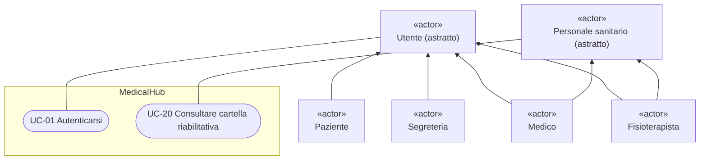
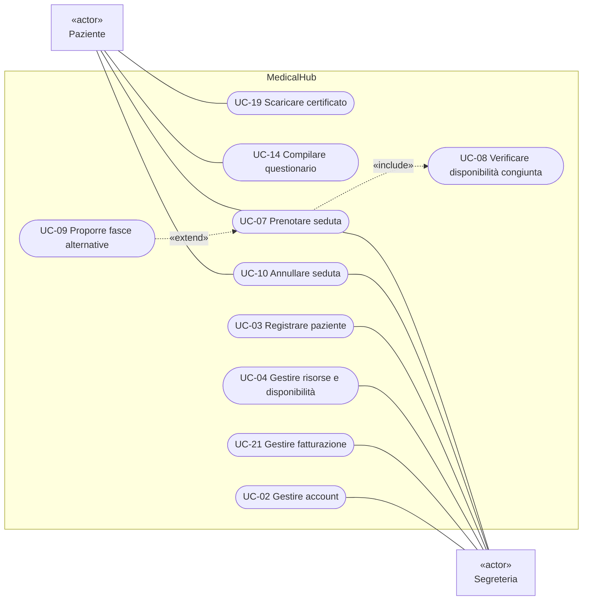
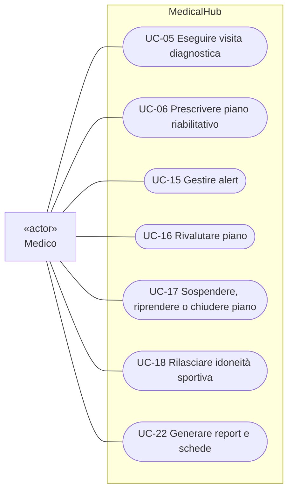
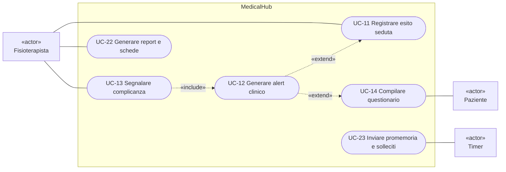
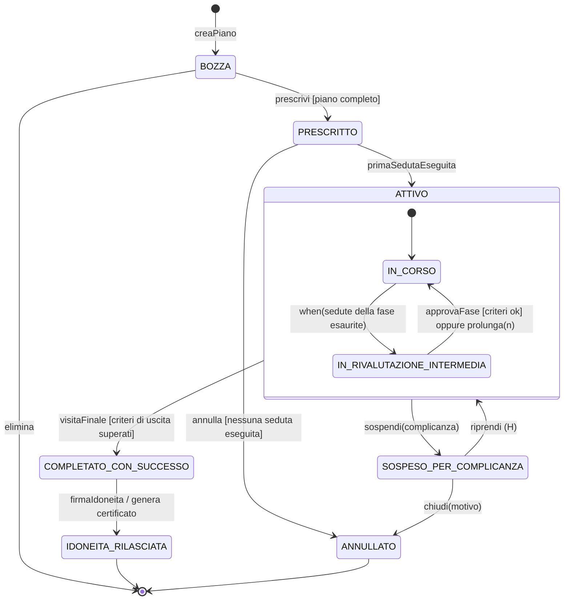

# 03_Requirements.md

*Specifica dei requisiti (IEEE 830) e qualità del software*

- **Corso:** Ingegneria del Software — A.A. 2026/27, Università degli Studi di Bergamo
- **Docenti:** Prof. Angelo Gargantini, Dott.ssa Silvia Bonfanti
- **Team:** Franchini Mattia (1099581), Ghislanzoni Fabio (1099423), Mazzoleni Lino (1098962), Ivasco Riccardo (1101140)

| Versione | Data | Autore | Descrizione delle modifiche |
|---|---|---|---|
| 1.0.0 | 12-10-2026 | Ivasco Riccardo | Prima stesura

## 1. Introduzione

### 1.1 Scopo e ambito

MedicalHub è un'applicazione per centri di fisioterapia e medicina dello sport che digitalizza il ciclo di vita del **piano riabilitativo**: visita diagnostica e prescrizione, prenotazione di sedute vincolate alla disponibilità di fisioterapisti, sale e macchinari, monitoraggio oggettivo dei progressi, rilascio dell'**idoneità sportiva**. Gli obiettivi sono la continuità tra medico e fisioterapista, l'assenza di conflitti sulle risorse ad alta richiesta (Tecar, laser, vasca), la rilevazione tempestiva delle complicanze e un'idoneità rilasciata solo su base oggettiva.

### 1.2 Definizioni

- **Piano riabilitativo**: sequenza ordinata di fasi prescritta dal medico; ogni fase ha terapie, numero di sedute, obiettivi e criteri di passaggio. Il piano è **aperto** finché non raggiunge uno stato finale (IDONEITA_RILASCIATA o ANNULLATO).
- **Protocollo**: modello di piano predefinito per un intervento, ad esempio la ricostruzione del legamento crociato anteriore (Post-Op LCA).
- **Seduta**: appuntamento che impegna paziente, fisioterapista e una **risorsa** (sala o macchinario con capacità massima).
- **Criterio di uscita**: condizione misurabile da superare per ottenere l'idoneità, ad esempio «LSI quadricipite ≥ 90%».
- **Alert clinico**: segnalazione automatica al medico curante per un parametro oltre soglia o una complicanza.
- **ROM** (*Range of Motion*): ampiezza del movimento articolare, in gradi. **NRS** (*Numeric Rating Scale*): dolore da 0 a 10. **LSI** (*Limb Symmetry Index*): rapporto percentuale tra arto operato e arto sano in un test di forza o di salto.

## 2. Elicitazione dei requisiti

**Stakeholder e fonti.** Gli stakeholder diretti sono i quattro attori (§3.2); quelli indiretti sono i docenti, che fissano i vincoli tecnologici. Le fonti sono scenari clinici di riabilitazione post-operatoria, protocolli riabilitativi a fasi e gli strumenti oggi in uso nei centri (agende cartacee, schede di valutazione, fogli Excel).

**Scenari di esempio.** *S1*: Luca, calciatore operato al crociato, viene registrato con la convenzione della sua federazione; la dottoressa crea il piano dal protocollo Post-Op LCA, Luca prenota solo in orari in cui fisioterapista e sala sono liberi e, superati i test di uscita, riceve l'idoneità. *S2*: in una seduta il fisioterapista registra dolore 8/10 e una flessione di 15° inferiore alla volta precedente; il sistema avvisa la dottoressa, che sospende il piano e lo riprende dopo la visita di controllo.

**Prioritizzazione.** Come previsto dal Project Plan si usa MoSCoW: **Must have** = nucleo del sistema, implementato e testato entro la milestone M3; **Should have** = importante, entro M4; **Could have** = solo se il tempo lo consente; i **Won't have** sono in §3.4. I requisiti funzionali sono 32: 20 M, 10 S, 2 C.

## 3. Descrizione generale

### 3.1 Prospettiva del prodotto

MedicalHub è un prodotto nuovo e autonomo che sostituisce carta e fogli di calcolo: un'applicazione Java eseguita localmente, con database H2 embedded, senza servizi esterni né rete, organizzata a livelli (Controller, Service, Repository, Model).

### 3.2 Utenti

- **Paziente / Atleta**: competenze informatiche eterogenee; uso saltuario (prenotazioni, questionari, certificato).
- **Medico dello Sport / Ortopedico**: responsabile clinico del piano, con poco tempo; visite, prescrizioni, alert, idoneità.
- **Fisioterapista**: esegue le sedute e usa il sistema durante il turno per agenda e parametri.
- **Segreteria**: accettazione, agenda, risorse e fatturazione.

### 3.3 Vincoli e assunzioni

- Vincoli del corso: Java, progetto Eclipse con Maven, database embedded, nessun servizio esterno, nessun percorso assoluto, sviluppo su GitHub; circa 110 ore-uomo in 4 sprint.
- I dati sanitari sono categorie particolari di dati personali (GDPR, art. 9): il prototipo usa solo dati fittizi, ma con controllo degli accessi e tracciabilità.
- Le misure sono inserite a mano; le notifiche sono interne all'applicazione (niente email o SMS).
- La firma dell'idoneità è **applicativa** (riautenticazione del medico e impronta hash del certificato).
- Protocolli, soglie e tariffe sono dati di esempio.

### 3.4 Esclusi dalla versione 1.0 (*Won't have*)

App mobile o portale web con API REST, integrazione con il Fascicolo Sanitario Elettronico, pagamenti elettronici, firma digitale qualificata, sensori indossabili e stime di recupero con intelligenza artificiale: tutte possibili estensioni future.

## 4. Requisiti specifici

Ogni requisito ha un identificatore univoco (`REQ-I` interfacce, `REQ-F` funzionali, `REQ-NF` non funzionali) e una priorità MoSCoW tra parentesi; dove utile, le tabelle riportano la motivazione del requisito. I valori di default sono configurabili (§4.5).

### 4.1 Interfacce esterne

| ID | Requisito / Motivazione |
|----|-------------------------|
| REQ-I-01 (M) | L'interfaccia, in italiano, deve mostrare solo le funzioni del ruolo dell'utente e validare i dati prima del salvataggio (campi obbligatori, intervalli di §4.5), indicando il campo errato. *Motivazione:* gli utenti hanno competenze informatiche eterogenee e poco tempo (§3.2): un'interfaccia limitata al proprio ruolo e una validazione immediata riducono gli errori di inserimento. |
| REQ-I-02 (S) | Le sedute devono essere consultabili per giorno o settimana, filtrate per fisioterapista o risorsa. *Motivazione:* sostituisce le agende cartacee: il fisioterapista vede il proprio turno, la Segreteria l'occupazione di sale e macchinari. |
| REQ-I-03 (M) | La persistenza deve usare JDBC su un database H2 embedded; il log deve usare log4j 2, gestito come dipendenza Maven. *Motivazione:* i docenti devono eseguire il progetto su un altro PC con solo JDK e Maven, senza installare un DBMS. |
| REQ-I-04 (S) | Certificati e report devono essere esportabili in PDF. *Motivazione:* l'applicazione non ha rete né email: il PDF permette di consegnare certificati e report fuori dal sistema. |

### 4.2 Requisiti funzionali

**Accesso e anagrafica**

| ID | Requisito / Motivazione |
|----|-------------------------|
| REQ-F-01 (M) | Il sistema deve consentire l'accesso solo con credenziali personali; ogni utente ha un ruolo (Paziente, Medico, Fisioterapista, Segreteria) e vede solo funzioni e dati di sua competenza. *Motivazione:* i dati sanitari sono categorie particolari di dati personali e richiedono controllo degli accessi e tracciabilità. |
| REQ-F-02 (S) | La Segreteria deve poter creare, modificare e disattivare gli account. |
| REQ-F-03 (M) | La Segreteria deve poter registrare un paziente con anagrafica, codice fiscale (formalmente valido e univoco), sport e tipo di pagante: privato, convenzione con federazione o assicurazione. *Motivazione:* il codice fiscale univoco evita anagrafiche duplicate; il tipo di pagante determina l'importo delle sedute (REQ-F-28). |
| REQ-F-04 (M) | La Segreteria deve poter assegnare a ogni paziente un medico curante e un fisioterapista di riferimento. *Motivazione:* continuità tra medico e fisioterapista (§1.1): gli alert vanno al medico curante (REQ-F-18) e le sedute si prenotano con il fisioterapista di riferimento (REQ-F-11). |
| REQ-F-05 (C) | La Segreteria deve poter registrare pacchetti di sedute con scadenza. |

**Visita e prescrizione**

| ID | Requisito / Motivazione |
|----|-------------------------|
| REQ-F-06 (M) | Il Medico deve poter registrare la visita diagnostica: diagnosi, articolazione e lato, valori basali di ROM, dolore e forza. *Motivazione:* i valori basali sono il riferimento per misurare i progressi (§4.5). |
| REQ-F-07 (M) | Il Medico deve poter creare un piano in stato BOZZA copiando un protocollo del catalogo o da zero, e personalizzarne fasi, terapie, sedute, obiettivi e soglie di alert. *Motivazione:* il protocollo velocizza la prescrizione dei casi frequenti, come il Post-Op LCA, ma ogni paziente richiede adattamenti. |
| REQ-F-08 (M) | Il Medico deve poter definire criteri di uscita misurabili nella forma *parametro – operatore – soglia*. *Motivazione:* l'idoneità deve essere rilasciata solo su base oggettiva (§1.1). |
| REQ-F-09 (M) | La prescrizione (BOZZA → PRESCRITTO) deve essere consentita solo se ogni fase ha almeno una terapia e una seduta, esiste almeno un criterio di uscita e il paziente non ha un altro piano aperto per la stessa articolazione e lo stesso lato. *Motivazione:* senza criteri di uscita l'idoneità non avrebbe base oggettiva; due piani aperti sulla stessa articolazione e lo stesso lato sarebbero in conflitto. |

**Risorse e prenotazioni**

| ID | Requisito / Motivazione |
|----|-------------------------|
| REQ-F-10 (M) | La Segreteria deve poter gestire sale e macchinari (tipo, capacità, indisponibilità) e orari e assenze dei fisioterapisti; ogni terapia indica il tipo di risorsa richiesto e la durata. *Motivazione:* sono i dati su cui si verifica la disponibilità al momento della prenotazione (REQ-F-11). |
| REQ-F-11 (M) | Una prenotazione deve essere accettata solo se, per tutta la seduta e negli orari di apertura, sono liberi insieme il fisioterapista di riferimento, una risorsa del tipo richiesto con capacità residua e il paziente. *Motivazione:* evita conflitti sulle risorse ad alta richiesta come Tecar, laser e vasca (§1.1). |
| REQ-F-12 (S) | Se la fascia richiesta non è disponibile, il sistema deve proporre le prime 3 fasce compatibili nei 14 giorni successivi. |
| REQ-F-13 (M) | Il Paziente deve poter prenotare le proprie sedute e la Segreteria quelle di chiunque, solo per piani PRESCRITTO o IN_CORSO ed entro le sedute previste dalla fase corrente. *Motivazione:* ogni seduta prenotata deve corrispondere a quanto prescritto dal medico. |
| REQ-F-14 (S) | Paziente e Segreteria devono poter annullare una seduta; con meno di 24 ore di preavviso l'annullamento è tardivo. *Motivazione:* l'annullamento tardivo comporta una penale (§4.5). |
| REQ-F-15 (M) | Una seduta deve essere PRENOTATA, ESEGUITA, NON_PRESENTATO o ANNULLATA; solo da PRENOTATA si passa agli altri stati. *Motivazione:* lo stato finale della seduta determina importo o penale (§4.5), quindi non deve più cambiare. |

**Sedute e monitoraggio**

| ID | Requisito / Motivazione |
|----|-------------------------|
| REQ-F-16 (M) | Il Fisioterapista deve poter consultare la propria agenda e lo storico dei parametri di ogni paziente. *Motivazione:* il fisioterapista usa il sistema durante il turno (§3.2) e confronta ogni misura con le precedenti. |
| REQ-F-17 (M) | Il Fisioterapista deve poter registrare l'esito di una seduta (terapie, ROM in flessione ed estensione, dolore NRS, carichi, note) o l'assenza del paziente; la prima seduta eseguita porta il piano in IN_CORSO. *Motivazione:* le misure registrate alimentano gli alert (REQ-F-18) e la verifica dei criteri di uscita (REQ-F-24). |
| REQ-F-18 (M) | Il sistema deve inviare un alert al medico curante se il dolore è pari o superiore alla soglia (default 7), se la flessione cala più della soglia rispetto alla misura precedente (default 10°) o se il fisioterapista segnala una complicanza. *Motivazione:* le complicanze vanno rilevate tempestivamente (§1.1). |
| REQ-F-19 (S) | Il Paziente deve poter compilare un questionario periodico di autovalutazione (default ogni 7 giorni); un dolore pari o superiore alla soglia genera un alert. *Motivazione:* rileva il dolore anche tra una seduta e l'altra. |
| REQ-F-20 (M) | Il Medico deve poter chiudere ogni alert con un esito: nessuna azione o sospensione del piano. |
| REQ-F-21 (S) | Il sistema deve mostrare l'andamento dei parametri e la percentuale di raggiungimento degli obiettivi (§4.5). *Motivazione:* rende oggettivo il monitoraggio dei progressi (§1.1). |

**Rivalutazione e idoneità**

| ID | Requisito / Motivazione |
|----|-------------------------|
| REQ-F-22 (M) | Esaurite le sedute della fase, il piano deve passare in IN_RIVALUTAZIONE_INTERMEDIA; il Medico approva la fase successiva, solo se i criteri di passaggio sono superati, oppure prolunga la fase. *Motivazione:* passare di fase prima di aver superato i criteri espone il paziente a complicanze. |
| REQ-F-23 (M) | Il Medico deve poter sospendere un piano per complicanza (il sistema annulla le sedute future e libera le risorse), riprenderlo dallo stato in cui era o chiuderlo (ANNULLATO). *Motivazione:* le risorse non restano bloccate da sedute che non si svolgeranno. |
| REQ-F-24 (M) | Dopo la visita finale il piano deve passare in COMPLETATO_CON_SUCCESSO solo se tutti i criteri di uscita sono superati; altrimenti il sistema elenca quelli mancanti. *Motivazione:* un errore sui criteri di uscita rimanderebbe in campo un atleta non guarito (§5). |
| REQ-F-25 (M) | Il certificato di idoneità deve poter essere emesso solo per piani COMPLETATO_CON_SUCCESSO, con firma del medico curante (reinserimento della password); riporta identificativo, data, criteri superati e impronta hash, e porta il piano in IDONEITA_RILASCIATA. *Motivazione:* la firma è applicativa (§3.3): la password identifica il medico e l'impronta hash rende rilevabile ogni modifica del certificato. |
| REQ-F-26 (S) | Il Paziente deve poter scaricare il certificato in PDF. |
| REQ-F-27 (C) | Il sistema deve sollecitare il medico se un piano resta in rivalutazione oltre 7 giorni o sospeso oltre 60. *Motivazione:* evita che un piano resti fermo per dimenticanza. |

**Fatturazione, notifiche e report**

| ID | Requisito / Motivazione |
|----|-------------------------|
| REQ-F-28 (S) | Il sistema deve calcolare l'importo di ogni seduta in base al tipo di pagante, con penale per annullamenti tardivi e assenze (§4.5). *Motivazione:* privati, convenzioni e assicurazioni pagano in modo diverso; la penale scoraggia annullamenti tardivi e assenze, che lasciano risorse inutilizzate. |
| REQ-F-29 (S) | La Segreteria deve poter generare il riepilogo mensile per paziente, separando la quota del paziente da quella dell'assicurazione. *Motivazione:* l'assicurazione copre solo una parte dell'importo, entro un massimale (§4.5). |
| REQ-F-30 (M) | Il sistema deve notificare nella bacheca interna alert, cambi di stato del piano, prenotazioni e annullamenti agli utenti interessati. *Motivazione:* tiene allineati medico, fisioterapista, paziente e Segreteria senza email né SMS (§3.3). |
| REQ-F-31 (S) | Il sistema deve generare un promemoria per il paziente 24 ore prima di ogni seduta e alla scadenza dei questionari. *Motivazione:* riduce assenze e questionari non compilati. |
| REQ-F-32 (S) | Il Medico deve poter generare in PDF il report di avanzamento del piano e il Fisioterapista la scheda degli esercizi domiciliari. |

### 4.3 Casi d'uso

Gli attori Paziente, Medico, Fisioterapista e Segreteria specializzano l'attore astratto **Utente** (*Autenticarsi*); Medico e Fisioterapista specializzano anche **Personale sanitario** (*Consultare cartella riabilitativa*). L'attore **Timer** avvia promemoria e solleciti.

Il diagramma dei casi d'uso è diviso in quattro viste per leggibilità (sorgente completa: `MedicalHub.mdj`).

*Figura 1a — Attori astratti e generalizzazioni (le frecce tra attori indicano la specializzazione; gli attori sono marcati «actor»).*

*Figura 1b — Casi d'uso di Paziente e Segreteria.*

*Figura 1c — Casi d'uso del Medico.*

*Figura 1d — Casi d'uso di Fisioterapista e Timer, con la generazione degli alert.*

Relazioni: *Prenotare seduta* «include» *Verificare disponibilità congiunta*; *Proporre fasce alternative* «extend» *Prenotare seduta* (punto di estensione: fascia non disponibile); *Generare alert clinico* «extend» *Registrare esito seduta* e *Compilare questionario* (soglia superata); *Segnalare complicanza* «include» *Generare alert clinico*.

Elenco dei casi d'uso (attore primario · requisiti, con prefisso `REQ-` omesso; REQ-F-30 sulle notifiche è trasversale):

- **UC-01** Autenticarsi — Utente · F-01
- **UC-02** Gestire account — Segreteria · F-02
- **UC-03** Registrare paziente — Segreteria · F-03 – F-05
- **UC-04** Gestire risorse e disponibilità — Segreteria · F-10
- **UC-05** Eseguire visita diagnostica — Medico · F-06
- **UC-06** Prescrivere piano riabilitativo — Medico · F-07 – F-09
- **UC-07** Prenotare seduta — Paziente, Segreteria · F-13
- **UC-08** Verificare disponibilità congiunta — incluso da UC-07 · F-11
- **UC-09** Proporre fasce alternative — estende UC-07 · F-12
- **UC-10** Annullare seduta — Paziente, Segreteria · F-14, F-15
- **UC-11** Registrare esito seduta — Fisioterapista · F-15, F-17
- **UC-12** Generare alert clinico — estende UC-11 e UC-14, incluso da UC-13 · F-18
- **UC-13** Segnalare complicanza — Fisioterapista · F-18
- **UC-14** Compilare questionario — Paziente · F-19
- **UC-15** Gestire alert — Medico · F-20
- **UC-16** Rivalutare piano — Medico · F-22
- **UC-17** Sospendere, riprendere o chiudere piano — Medico · F-23
- **UC-18** Rilasciare idoneità sportiva — Medico · F-24, F-25
- **UC-19** Scaricare certificato — Paziente · F-26
- **UC-20** Consultare cartella riabilitativa — Personale sanitario · F-16, F-21
- **UC-21** Gestire fatturazione — Segreteria · F-28, F-29
- **UC-22** Generare report e schede — Medico, Fisioterapista · F-32
- **UC-23** Inviare promemoria e solleciti — Timer · F-27, F-31

**UC-07 — Prenotare seduta.** *Attori:* Paziente o Segreteria. *Precondizione:* piano PRESCRITTO o IN_CORSO con sedute ancora da prenotare. *Postcondizione:* seduta PRENOTATA, fisioterapista e risorsa occupati.

1. L'utente sceglie una terapia della fase corrente, poi data e ora.
2. Il sistema verifica la disponibilità congiunta di fisioterapista, risorsa e paziente (*include* UC-08).
3. Il sistema registra la seduta e notifica paziente e fisioterapista.

*Estensioni:* 1a. Sedute della fase esaurite: prenotazione rifiutata. 2a. Fascia non disponibile (*extend* UC-09): il sistema propone 3 fasce alternative; l'utente ne sceglie una o rinuncia.

**UC-18 — Rilasciare idoneità sportiva.** *Attore:* Medico curante. *Precondizione:* piano in IN_RIVALUTAZIONE_INTERMEDIA al termine dell'ultima fase. *Postcondizione:* piano in IDONEITA_RILASCIATA, certificato disponibile al paziente.

1. Il medico registra la visita finale con i risultati dei test di uscita.
2. Il sistema verifica che tutti i criteri di uscita siano superati e porta il piano in COMPLETATO_CON_SUCCESSO.
3. Il medico firma reinserendo la password; il sistema genera il certificato e notifica il paziente.

*Estensioni:* 2a. Un criterio non è superato: il sistema elenca i criteri mancanti e blocca la firma; il medico può prolungare la fase o sospendere il piano. 3a. Password errata: firma rifiutata.

### 4.4 Ciclo di vita del piano riabilitativo

Il comportamento del sistema dipende dallo stato del piano (REQ-F-09, F-13, F-17, F-22 – F-25):

- **BOZZA**: in preparazione — modifica, prescrizione, eliminazione.
- **PRESCRITTO**: in attesa della prima seduta — prenotazioni, annullamento.
- **IN_CORSO**: fase in svolgimento — prenotazioni, sedute, questionari, sospensione.
- **IN_RIVALUTAZIONE_INTERMEDIA**: sedute della fase concluse — approvazione della fase, prolungamento, visita finale, sospensione.
- **SOSPESO_PER_COMPLICANZA**: percorso interrotto — ripresa o chiusura.
- **COMPLETATO_CON_SUCCESSO**: criteri di uscita superati — firma dell'idoneità.
- **IDONEITA_RILASCIATA** e **ANNULLATO**: stati finali, sola consultazione.

IN_CORSO e IN_RIVALUTAZIONE_INTERMEDIA sono sottostati dello stato composito **ATTIVO**: la sospensione vale per entrambi e la ripresa riporta nel sottostato di partenza (storia superficiale, H).

*Figura 2 — Ciclo di vita del piano (vista semplificata; il diagramma completo in StarUML è nel Documento 4).*

Transizioni (*evento [guardia] / azione*):

- **T1** → BOZZA: creaPiano(protocollo) / copia le fasi
- **T2** BOZZA → PRESCRITTO: prescrivi [piano completo ∧ nessun altro piano aperto per articolazione e lato]
- **T3** BOZZA → stato finale: elimina
- **T4** PRESCRITTO → IN_CORSO: primaSedutaEseguita
- **T5** PRESCRITTO → ANNULLATO: annulla [nessuna seduta eseguita]
- **T6** IN_CORSO → IN_RIVALUTAZIONE_INTERMEDIA: when(sedute eseguite = sedute previste) / notifica il medico
- **T7** IN_RIVALUTAZIONE_INTERMEDIA → IN_CORSO: approvaFase [criteri di passaggio superati ∧ fase non ultima] / fase successiva
- **T8** IN_RIVALUTAZIONE_INTERMEDIA → IN_CORSO: prolunga(n) [n > 0] / aggiunge n sedute
- **T9** IN_RIVALUTAZIONE_INTERMEDIA → COMPLETATO_CON_SUCCESSO: visitaFinale [fase ultima ∧ criteri di uscita superati]
- **T10** ATTIVO → SOSPESO_PER_COMPLICANZA: sospendi / annulla le sedute future, libera le risorse
- **T11** SOSPESO_PER_COMPLICANZA → ATTIVO (H): riprendi
- **T12** SOSPESO_PER_COMPLICANZA → ANNULLATO: chiudi(motivo)
- **T13** COMPLETATO_CON_SUCCESSO → IDONEITA_RILASCIATA: firmaIdoneita [password corretta] / genera il certificato

Transizioni interne: *after(7 giorni) / sollecito al medico* in IN_RIVALUTAZIONE_INTERMEDIA e *after(60 giorni) / sollecito al medico* in SOSPESO_PER_COMPLICANZA.

### 4.5 Dati, parametri e regole di calcolo

**Entità**: Utente, Paziente, Protocollo, Fase, Piano riabilitativo, Terapia, Risorsa, Seduta, Misurazione, Questionario, Alert, Certificato, Convenzione. **Vincoli di integrità**: username e codice fiscale univoci; al più un piano aperto per paziente, articolazione e lato; al più un certificato per piano; durate, tariffe e capacità positive.

**Parametri** (intervallo ammesso, default):

- ROM: da −30° a 180°; dolore NRS: interi da 0 a 10; LSI: da 0% a 150%.
- Soglia di dolore per l'alert: 1–10, default 7; soglia di calo della flessione: 5°–45°, default 10° (impostate dal medico per ogni piano).
- Frequenza del questionario: 1–30 giorni, default 7.
- Durata standard della seduta: 15–120 minuti, default 45.
- Preavviso del promemoria e preavviso minimo di annullamento: 0–72 ore, default 24.
- Penale per annullamento tardivo o assenza: 0–100% della tariffa, default 50%.
- Fasce alternative proposte: 1–10 entro 1–60 giorni, default 3 entro 14 giorni.

**Regole di calcolo**:

- *Raggiungimento di un obiettivo*: `P = (v − v0) / (vt − v0) × 100`, limitato a 0–100, con `v0` valore basale, `v` ultima misura e `vt` obiettivo (`P = 100` se `vt = v0`); vale sia per valori da aumentare (ROM) sia da ridurre (dolore).
- *LSI* = arto operato / arto sano × 100. Un *criterio di uscita* è superato se l'ultima misura rispetta l'operatore rispetto alla soglia; senza misura è non superato.
- *Importo di una seduta* con tariffa `T`: paziente privato `T`; convenzione con sconto `s%`: `T × (1 − s/100)`; assicurazione con copertura `c%` e massimale residuo `M`: l'assicurazione copre `A = min(T × c/100, M)` e il paziente paga `T − A`; annullamento tardivo o assenza: penale `p%` di `T` a carico del paziente.

### 4.6 Requisiti non funzionali

- **REQ-NF-01 (S) Prestazioni** — La verifica di disponibilità e la ricerca di alternative devono richiedere meno di 1 s con 1.000 pazienti, 30 risorse e 50.000 sedute; le altre operazioni interattive meno di 2 s.
- **REQ-NF-02 (M) Vincoli di progetto** — Progetto Eclipse Maven in Java 17 o superiore, test JUnit 5 in `src/test/java`; `mvn clean test` deve passare su un PC con solo JDK e Maven, senza servizi esterni né percorsi assoluti.
- **REQ-NF-03 (M) Architettura** — Livelli controller, service, repository e model senza cicli tra package; Oracle Java Code Conventions.
- **REQ-NF-04 (M) Sicurezza** — Password salvate solo come hash con salt (PBKDF2); ogni operazione clinica registrata nel log di audit con utente, data e oggetto, mai con dati sanitari in chiaro.
- **REQ-NF-05 (C) Sicurezza** — Blocco dell'account per 15 minuti dopo 5 accessi falliti consecutivi.
- **REQ-NF-06 (M) Affidabilità** — Operazioni su più entità atomiche; nessuna perdita delle operazioni già confermate in caso di chiusura improvvisa.
- **REQ-NF-07 (M) Manutenibilità** — Branch e line coverage ≥ 75% sui package service e model (EclEmma/JaCoCo).
- **REQ-NF-08 (S) Manutenibilità** — Complessità ciclomatica ≤ 10 per metodo; nessun problema critico segnalato da SonarLint o PMD.
- **REQ-NF-09 (S) Usabilità** — Dopo 15 minuti di dimostrazione un fisioterapista registra una seduta in meno di 2 minuti; messaggi di errore in italiano, senza dettagli tecnici.
- **REQ-NF-10 (S) Portabilità** — Funzionamento senza modifiche su Windows, macOS e Linux con JDK 17 o superiore.

## 5. Qualità del software

Come nel cap. 6 di [2] si usa il modello ISO/IEC 9126 [4], trattando la sicurezza come caratteristica autonoma come nella ISO/IEC 25010, data la natura sanitaria dei dati. Le qualità che guidano il progetto, in ordine di priorità:

- **Funzionalità – accuratezza (alta).** Un errore sui criteri di uscita rimanderebbe in campo un atleta non guarito, uno sulle prenotazioni bloccherebbe il centro: regole e formule sono esplicite (§4.5) e testate sui valori limite (REQ-F-11, REQ-F-24, REQ-F-25).
- **Sicurezza (alta).** I dati sanitari richiedono riservatezza e tracciabilità: accesso per ruolo, hash delle password, log di audit (REQ-F-01, REQ-NF-04).
- **Affidabilità (alta).** Piano e agenda sono l'unica fonte di verità: operazioni atomiche e test di ogni transizione di stato (REQ-NF-06).
- **Manutenibilità (alta).** Protocolli, tariffe e notifiche cambiano nel tempo e la qualità del codice è valutata: parti variabili isolate con design pattern (Documento 4), copertura ≥ 75%, McCabe ≤ 10, nessun ciclo tra package (REQ-NF-03, REQ-NF-07, REQ-NF-08).
- **Usabilità (media).** Il personale ha poco tempo e registra i dati durante il turno: interfaccia per ruolo e validazione immediata (REQ-I-01, REQ-NF-09).
- **Portabilità (media).** I docenti devono eseguire il progetto su un altro PC: Maven, H2 embedded, percorsi relativi (REQ-NF-02, REQ-NF-10).
- **Efficienza (bassa).** I volumi di un singolo centro sono modesti (REQ-NF-01).

**Qualità esterne e interne.** Seguendo la distinzione della ISO/IEC 9126, le qualità esterne (accuratezza, sicurezza, affidabilità, usabilità, portabilità, efficienza) si osservano sul sistema in esecuzione e si verificano con test e prove d'uso; la manutenibilità è una qualità interna e si misura sul codice con metriche statiche.

**Verifica.** Ogni qualità ha un controllo concreto, ripetuto a ogni sprint:

| Qualità | Come si verifica | Requisiti |
|---|---|---|
| Accuratezza | Test JUnit sui valori limite di formule, soglie e disponibilità congiunta | REQ-F-11, REQ-F-24, REQ-F-28 |
| Sicurezza | Test sull'accesso per ruolo e sull'hash delle password; controllo che il log di audit non contenga dati sanitari | REQ-F-01, REQ-NF-04 |
| Affidabilità | Un test per ogni transizione del ciclo di vita (§4.4), comprese quelle non ammesse; verifica che un'operazione fallita su più entità non lasci modifiche parziali | REQ-NF-06 |
| Manutenibilità | Copertura con EclEmma/JaCoCo, complessità e problemi critici con SonarLint/PMD, controllo dei cicli tra package | REQ-NF-03, REQ-NF-07, REQ-NF-08 |
| Usabilità | Prova con una persona esterna al team nel ruolo di fisioterapista, cronometrando la registrazione di una seduta | REQ-NF-09 |
| Portabilità | `mvn clean test` su un PC con solo JDK e Maven, su Windows, macOS e Linux | REQ-NF-02, REQ-NF-10 |
| Efficienza | Test con dati generati ai volumi di REQ-NF-01 | REQ-NF-01 |

**Qualità non perseguite.** L'interoperabilità non è un obiettivo della versione 1.0: il sistema non scambia dati con altri sistemi (§3.4).

**Compromessi.** La riautenticazione è richiesta solo per la firma dell'idoneità, per non appesantire l'uso quotidiano; con circa 110 ore-uomo i requisiti *Could* si sacrificano per primi, per non compromettere qualità e test dei *Must*.